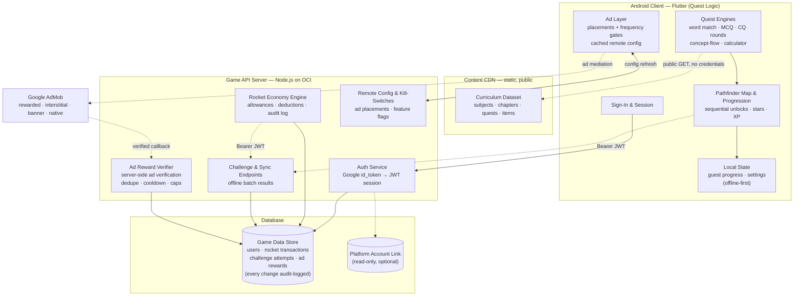

# SSC Quest · Gamified Learning Adventure for Bangladesh's SSC Students

[](#live-demo--media)
[](#tech-stack)
[](#tech-stack)
[](#key-features)
[](#monetization--engagement-strategy)
[](#live-demo--media)

> **Turn the NCTB Class 9–10 syllabus into a quest map — clear chapters, earn stars, spend rockets, and level up from SSC student to SSC champion.**

**SSC Quest** (মুক্তিবেগ – SSC Pathfinder) is a production-grade, gamified educational Android game that transforms Bangladesh's **SSC (Secondary School Certificate, Class 9–10)** science curriculum into a chapter-by-chapter adventure. Instead of reading a textbook, students battle through **quest blocks on a pathfinder map**: matching scientific terms, solving real board-exam MCQ worksheets, cracking scenario-based creative-question (উদ্দীপক CQ) rounds, re-ordering concept flows, and working calculator problems — with stars, XP streaks, a rocket "life" economy, and a celebration robot that keeps them coming back.

The Android game is the native Flutter edition of a web game sharing the **same live content pipeline** — 7 subjects, 91 chapters, and 1,000+ quests (4,000+ items) mined from NCTB textbooks and real test-paper archives — served over a public CDN with zero credentials in the app. A lightweight cloud game server handles sign-in, cross-device progression, the rocket economy, and server-verified ad rewards.

Built for the **Muktibeg** learning ecosystem, it ships alongside companion apps (SSC Bookshelf, the flashcard app, and the Campus platform) on a shared multi-app backend.

---

## About This Repository

This is a **client-facing portfolio showcase**. The production source code for the mobile game and the game server lives in **private repositories** to protect the product's intellectual property.

What this repository documents — at a level of abstraction appropriate for clients, collaborators, and technical reviewers:

- what the game does and who it's for,
- how the Pathfinder quest mechanics and progression system work,
- how the backend manages game state, sync, and server-verified rewards,
- the monetization and retention design, and
- the high-level architecture and technology choices behind each layer.

No API keys, AdMob publisher identifiers, signing keys, database schemas, proprietary grading internals, or infrastructure addresses are (or ever will be) shared here.

## Table of Contents

1. [Target Audience & Business Value](#target-audience--business-value)
2. [Key Features](#key-features)
3. [Monetization & Engagement Strategy](#monetization--engagement-strategy)
4. [High-Level Architecture](#high-level-architecture)
5. [Tech Stack](#tech-stack)
6. [Live Demo & Media](#live-demo--media)
7. [Repository Structure](#repository-structure)
8. [Security & Privacy Notes](#security--privacy-notes)
9. [About the Developer](#about-the-developer)

---

## Target Audience & Business Value

**Who it serves.**

- **SSC students (Class 9–10) in Bangladesh** following the NCTB curriculum — the primary players. The content covers the full science-side subject spread: physics, chemistry, higher mathematics, biology, general mathematics, ICT, and Bangladesh & Global Studies. These are 14–16 year-olds preparing for one of the most consequential exams of their lives, on affordable Android devices, often studying in Bengali.
- **The Muktibeg ecosystem** — the game is the engagement and brand-acquisition layer of a wider learning platform (Campus SaaS, flashcards, textbook reader), converting free players into the ecosystem's broader offerings.

**Why it works as a business.**

- **Genuine learning value first.** Every quest is real curriculum content — actual past test-paper questions and textbook concepts — so the game competes with tutoring, not just with other games.
- **Habit-forming loops.** Sequential quest unlocks, 3-star mastery, XP best-delta scoring, daily rocket allowances, and musical celebration moments are engineered for daily return visits.
- **Mobile-first for the market.** Bengali-first UI with per-glyph font fallback, offline-capable local progress, guest mode with no sign-up wall, and low-end device friendliness — matching exactly how the audience actually plays.
- **Zero-release operations.** Ads, features, and content updates are controlled remotely from the server operator config — a bad ad placement can be switched off for every install instantly, without waiting for a Play Store review.
- **A scalable game platform, not a one-off app.** The backend is deliberately exam-agnostic: SSC ships today, and additional exam families (HSC, job exams) are new route folders — not rewrites. The same pattern already powers two companion apps.
- **Cheap to run.** Static content on a CDN, a single lightweight API server, and one small database keep infrastructure costs near zero while the content library scales.

---

## Key Features

**Pathfinder quest mechanics**

- **Block-flow chapter maps** — students pick a subject, open a chapter, and clear quests sequentially on a visual path; only the next unsolved quest is "alive," keeping focus on one goal at a time.
- **Five quest engines**, each a distinct mini-game built on real exam content:
  - **Word Match** — pair scientific terms with their meanings;
  - **MCQ Worksheets** — real test-paper multiple-choice sets (10+ questions each) with instant feedback;
  - **Creative-Question (CQ) Rounds** — scenario/stimulus-based questions in the authentic SSC exam format;
  - **Concept-Flow Ordering** — re-arrange shuffled steps of a process into the correct sequence;
  - **Calculator Problems** — step-by-step worked math problems with a custom in-app math renderer.
- **Star & XP mastery system** — pass bar at ≥50% correct; 3 stars for a flawless clear, 2 stars for ≤25% wrong, 1 star otherwise; XP awarded as the gain over your previous best, so replaying a mastered quest can't farm points.
- **Growth-mindset feedback** — a miss shows encouragement ("one try wasn't enough"), never a red "wrong" — deliberate pedagogy in the failure copy.

**Rocket economy & progression (server-managed)**

- **Rockets as lives** — players start with a pool of permanent + daily rockets; a failed challenge costs one, a first-try clear costs nothing, and the daily allowance refreshes without accumulating.
- **Server-authoritative accounting** — every rocket change is computed, validated, and audit-logged on the backend; the client can never invent currency.
- **Offline-first sync** — guests play fully offline with local progress; signed-in players sync batches of offline results when they return.

**Content & experience**

- **Live curriculum dataset** — 7 subjects · 91 chapters · 1,000+ quests (4,000+ items) streamed from a public CDN; content updates reach every install without an app release.
- **Hand-crafted game feel** — animated vector mascots (sun buddy, moon buddy, celebration robot) drawn entirely in code, physics confetti, tile animations, and a gapless 8-track public-domain piano soundtrack — with a special music reward for three consecutive perfect clears.
- **Bengali-first bilingual UI** — a warm watercolor light theme and a moonlit dark theme, with a custom math renderer that keeps Bengali text and LaTeX-style formulas (fractions, radicals, symbols) typeset correctly side by side.

**Backend management**

- **Google Sign-In → JWT sessions** — one-tap mobile sign-in issuing short-lived bearer tokens; guest mode always available.
- **Remote configuration & kill-switches** — every ad placement, frequency gate, and economy parameter is served from the server's operator config and re-checked at launch, on resume, and after every sync; a master switch disables all advertising instantly, platform-wide.
- **Ad-reward verification** — rewarded-ad payouts are credited only after cryptographically verified confirmation from the ad network (server-side verification), with deduplication, cooldowns, and hourly caps enforced on the server.
- **Ops dashboard** — a protected operator board tracks project workstreams across app, server, CDN, and store — including the live ad-switch toggle.
- **Automated release pipeline** — CI runs static analysis, unit tests, and a live-dataset end-to-end parse of every quest on every push, then builds and signs release artifacts with keystore secrets that never touch the repository.

---

## Monetization & Engagement Strategy

**Advertising with the player experience protected.** The game monetizes through Google AdMob with a placement policy that never interrupts learning: interstitials appear **only when exiting a finished quest** (never mid-quest or on completion screens), app-open ads only on return from background (never cold start), banners confined to a fixed container, and native units woven between quest blocks on the list. Every placement is gated by master/unit flags, per-user switches, and minimum-interval guards — all delivered by remote config, so tuning never requires an app update. Sideloaded development installs always serve test ad units; production units run only for store installs.

**Rewarded ads inside the economy.** Two rewarded placements tie advertising directly into the game's value loops:

- **Rocket Center** — watch a short video, earn a bonus rocket (the "extra life" currency), credited only after server-side ad verification with anti-abuse caps.
- **Quest-Unlock Offer** — when a player finishes a quest *close* to the pass bar (above 50% but not passing), the game offers a short rewarded video that unlocks the next quest immediately — converting a frustrating near-miss into either a second attempt or forward momentum. The unlock itself is the reward; no currency changes hands.

**Retention loops.** Sequential map progression creates a visible "just one more quest" pull; daily non-cumulative rockets encourage short, frequent sessions over binges; star mastery and best-delta XP reward *improvement*, not grinding; and celebratory moments (confetti, win jingles, the three-perfect music reward) punctuate the loop with dopamine the way entertainment games do — except here every minute spent is syllabus coverage.

---

## High-Level Architecture

A Flutter Android client talks to two cloud surfaces: a public CDN for the read-only curriculum dataset, and a lightweight Node.js game API for everything identity- and economy-related. The server is authoritative for currency and progression; the client is authoritative for nothing that matters.



**How a typical play session works**

1. **Launch** — the app refreshes remote config (ads, feature flags) and, if signed in, syncs any offline challenge results in a single batch; guests go straight to the map.
2. **Play** — the player clears quests on the chapter map; scoring runs locally, progress persists on-device instantly, and signed-in results are queued for sync.
3. **Economy** — first-try clears are free; a failed challenge spends a rocket. The server recomputes and audit-logs every transaction — the client's numbers are a cache, not a source of truth.
4. **Ads & rewards** — placements fire only at their gated moments; rewarded views are confirmed server-side (cryptographically verified) before any rocket is credited, with duplicate, cooldown, and rate protection.
5. **Content ops** — new chapters and quest fixes ship to the CDN and appear in the game without any release; ad tuning and kill-switches flow the same way.

**Design notes**

- **Server-authoritative currency.** All rocket math lives behind the API; an audit trail records every transaction, and abuse paths (replayed ad rewards, fake results) are structurally rejected.
- **Client-side delight, server-side trust.** Animation, audio, and theming live fully on-device; identity, economy, and verification live fully on the server — each side does what it's best at.
- **One backend, many games.** The API is organized as per-exam-family route trees (SSC today; HSC and job-exam games are additive), already shared with two companion apps — a platform pattern, not a single-product server.
- **Abstracted data layer.** A distributed, PostgreSQL-compatible SQL database holds users, attempts, transactions, and ad-reward records in a dedicated game database, isolated from the wider platform. Schema details are intentionally omitted from this showcase.

---

## Tech Stack

| Layer | Technology |
| --- | --- |
| **Mobile frontend** | Flutter (Dart), Android — Provider state management, custom mini-LaTeX math renderer, hand-drawn vector animation, audio engines for gapless BGM + low-latency SFX |
| **Ads** | Google AdMob (rewarded, interstitial, app-open, banner, native) with server-driven remote configuration and server-side verification |
| **Auth** | Google Sign-In (OpenID id_token) → short-lived JWT bearer sessions |
| **Backend** | Node.js + Express — auth, game economy, sync, ad-reward verification, remote config; rate limiting and audit logging built in |
| **Database** | CockroachDB (distributed, PostgreSQL-compatible SQL) — dedicated game database with transaction audit trail |
| **Content delivery** | Cloudflare edge (Worker + R2 object storage) serving the public curriculum dataset |
| **Cloud hosting** | Oracle Cloud Infrastructure — API server behind nginx with HTTPS |
| **CI/CD** | GitHub Actions — analyze → test → live-dataset E2E → signed APK/AAB builds and tagged releases (keystore held in CI secrets only) |

---

## Live Demo & Media

- **Live Play Store Link:** [Live Play Store Link — placeholder, public rollout in progress; the release build ships as an internal-testing/production AAB via Google Play]
- **Privacy policy (live):** [ SSC Quest Privacy Policy ](https://game-api.muktibeg.com/ssc-pathfinder/privacy-policy)
- **Demo Video Link:** [Demo Video Link — placeholder, to be added]
- **Screenshots:** [Screenshots — placeholder, to be added]

Drop production screenshots into `assets/screenshots/` and embed them here:

| Home & Subjects | Pathfinder Chapter Map | Quest: MCQ Worksheet | Quest: CQ Round | Rocket Center |
| :---: | :---: | :---: | :---: | :---: |
| `assets/screenshots/` | `assets/screenshots/` | `assets/screenshots/` | `assets/screenshots/` | `assets/screenshots/` |

---

## Repository Structure

```text
ssc-quest-pathfinder-portfolio/
├── README.md                  # This document — game architecture showcase
└── assets/
    └── screenshots/           # Game screenshots (to be added)
```

---

## Security & Privacy Notes

- No secrets ship in the app: the curriculum dataset is public-read, and ad unit identifiers are build-time fallbacks only — production values and kill-switches come from server config.
- Release signing keys are held exclusively in CI secrets; the repositories contain no keystores, API keys, or credentials.
- Ad-reward credits require cryptographically verified server-side confirmation, with deduplication, cooldowns, and hourly caps.
- Guests can play entirely without an account (progress stays on-device); signed-in users get a real, working in-app account-deletion flow backed by a live endpoint — built to Google Play's data-deletion policy.
- No database schemas, internal endpoints, or infrastructure addresses are shared in this showcase.
- For security inquiries, please open a GitHub issue in this repository or reach out via the developer profile below.

---

## About the Developer

**Ali Reza** — software developer and entrepreneur based in Chattogram, Bangladesh, building full-stack products across mobile, web, and cloud.

- GitHub: [AliRezaBmeDu](https://github.com/AliRezaBmeDu)
- Portfolio: [alireza-portfolio-den.netlify.app](https://alireza-portfolio-den.netlify.app/)
- LinkedIn: [mohammad-ali-reza](https://www.linkedin.com/in/mohammad-ali-reza-25686428b/)

Related showcases: [Muktibeg Flashcard Ecosystem](https://github.com/AliRezaBmeDu/flashcard-ecosystem-architecture) · [Muktibeg Campus SaaS](https://github.com/AliRezaBmeDu/showcase-muktibeg-campus-saas) — the wider learning platform this game belongs to.

---

*This repository documents the architecture of a production system. Product names and trademarks belong to their respective owners.*
